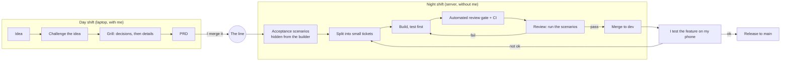

# Agent-run development workflow

A workflow in which a team of AI agents builds software and one human stays in the loop. I designed it and I run it for a side project. This repository describes how it works, what is mine, what I took from others, and what does not work well yet.

There is no product code here. The product I test the workflow on is private.

## The idea

The work is split into two shifts, with one line between them.

- **Day shift.** I work live with specialist agents on my laptop until an idea is an approved specification (a PRD).
- **The line.** The PRD is merged. My merge is the approval.
- **Night shift.** Agents on a server split the PRD into small tickets, build them in parallel, review them and merge them. I am not there.
- **Morning.** I test the finished feature on my phone and release it, or I send it back.

## Day shift: from idea to an approved PRD

Each agent has one job and a list of things it must never do.

| Agent | Job |
|---|---|
| The room | Several voices challenge the idea before anything is written. |
| Product manager | Asks me numbered questions in rounds, each with its own recommendation. First the big decisions, then the details: stories, acceptance criteria, what each screen shows. I accept or change each one on the spot. Then it writes the PRD. |
| Designer | Owns the design files and a "taste file" of rules I approved. |
| Architect | Decides the technical foundations with me and writes one decision record per choice. It tests before it picks. |
| Analyst | Quick research during the session. |

The rule behind this shift: nothing is left for a later agent to guess. A detail that is not in the PRD becomes a question to me, not an assumption.

## Night shift: from PRD to merged code

The agents run on a server under an orchestrator that wakes each one when it is its turn.

1. **Scenarios.** A product agent writes end-to-end acceptance scenarios from the PRD, including "never" scenarios. They are stored where the builder does not read them.
2. **Split.** An engineering lead agent splits the PRD into small vertical tickets. Ticket 1 is a tracer bullet: a thin slice through every layer. A ticket is blocked by another only when it needs its code, so several can run in parallel.
3. **I approve the split and the scenarios.** One card, one yes.
4. **Build.** A builder agent takes one ticket per run in its own git worktree, test first. Tests, types and lint must pass.
5. **Gate.** An automated review gate on a different model checks the branch and opens the pull request. Then CI runs.
6. **Review.** The engineering lead runs the hidden scenarios against the build in two browser engines. Scenarios that call an AI model run three times and must pass three times. A failure goes back to the builder with what happened, not with the scenario text. Then it checks the code against the ticket, the design files and the standards.
7. **Merge.** A passing ticket is merged into `dev`.
8. **Night watch.** A script checks every five minutes for stuck tickets, tickets closed without a merge, and a gate that ran out of usage. A supervising agent acts on what it finds and leaves me a note for the morning.

## Where the human is

1. The whole day shift.
2. Approving the split and the scenarios.
3. Testing each finished feature on a phone, then releasing `dev` into `main`.
4. Escalations: three failed review rounds, or a product question no agent can answer.
5. Tickets only a human can do.

Money, keys, deletes, anything on `main` and anything that changes the scope always wait for me.

## Every rule is a trial

Each rule of the workflow has a written "keep it if" check. If the check fails, the rule is dropped or changed. Some examples:

| Rule | Keep it if |
|---|---|
| The builder does not see the scenarios | At least 1 in 4 tickets is sent back by the scenario run and not by my own testing. Under 1 in 5 scenario failures are wrong scenarios. |
| I test once per feature, not once per ticket | My testing of one PRD stays one sitting, and features do not break between merges. |
| The night runs without me | A night chain finishes without me, and my testing finds under 1 bad ticket in 5. |
| Agents learn from mistakes (a lessons file per agent, which I approve weekly) | After two weeks, repeated mistakes go down. |

## What happened so far

- The workflow built its test case, a mobile app (TypeScript, React Native, Supabase): **170 pull requests merged in one week.**
- The count is high partly by design: tickets are small on purpose.
- One night stopped for six hours. The review gate ran out of usage, two tickets were stuck as blocked, and one ticket closed without its merge. Nobody was watching. The night watch (step 8) exists because of that night.
- In an early practice run the builder was the bottleneck, not the reviewer. More parallel lanes on one builder helped more than more agents.

## Honest limits

- **It is a side project.** The app has not been used in a real class yet.
- **Most of the rules are still trials.** I do not have enough runs to say which ones hold.
- **The scenarios are hidden softly.** The builder is told not to read them and they are not in its worktree. Nothing technical stops it.
- **The management layer is the weakest part.** The build loop (small tickets, gates, human testing) works better than the agents that manage other agents.
- **The agents test a web build of the app.** Native bugs are found only when I test on a phone.
- **A pull request count says nothing about quality.** The checks above are what I rely on, and my own testing is still the last one.

## What is mine and what is not

**Not mine:**
- The base flow (grill, PRD, small tickets, tracer bullets, a human testing at the end) comes from **Matt Pocock's** AI coding workflow, and the engineering agents use his skills.
- The day-shift agents are **BMAD** personas.
- The orchestrator on the server is **Paperclip**.
- The review gate is **No Mistakes**.
- "The builder does not write its own exam" is borrowed from **StrongDM's** software factory.
- The models are Claude and Codex.

**Mine:**
- The split into a day shift and a night shift, with the merged PRD as the line.
- The roles, their "never" lists and who reports to whom.
- How the hidden scenarios are written, stored and run.
- One human test per feature, on `dev`, before a release to `main`.
- The night watch and the rules for what agents may decide alone at night.
- The habit of treating every rule as a trial with a keep-or-drop check.

## Contact

Fadi Khamam - [LinkedIn](https://www.linkedin.com/in/fadi-khamam-552219172)
